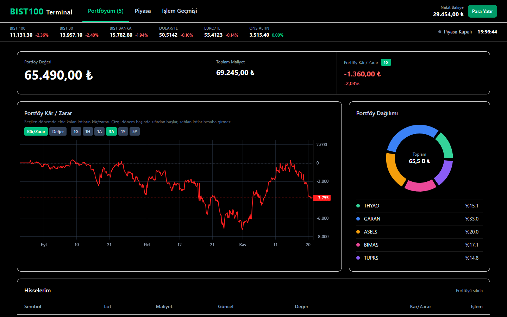
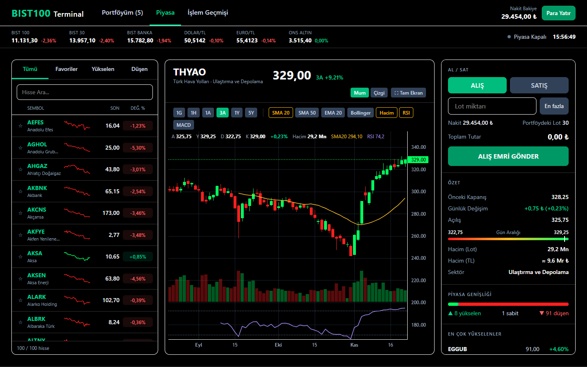
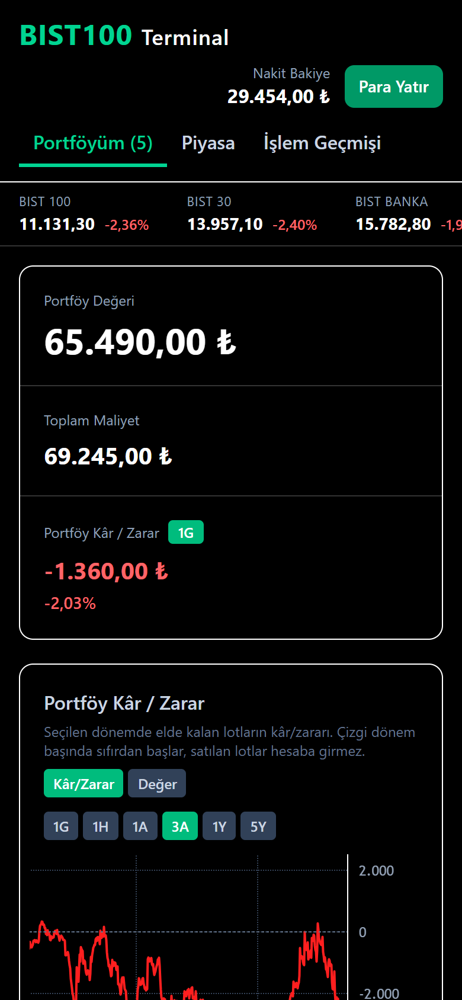
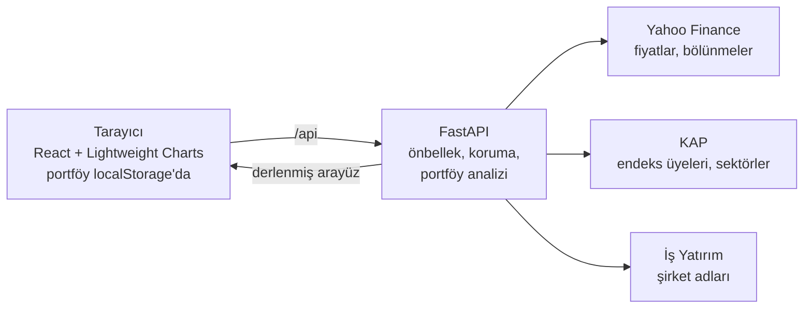

# BIST Terminal

[](https://github.com/ibrahim1y/BIST-Terminal/actions/workflows/testler.yml)

Borsa İstanbul hisselerini izlemek ve sanal alım-satım yapmak için bir web uygulaması. Gerçek emir göndermez, gerçek para kullanmaz.

**Canlı site:** [bist-terminal-pif6.onrender.com](https://bist-terminal-pif6.onrender.com)

> Site ücretsiz sunucuda çalışır. Bir süre ziyaret edilmezse uykuya geçer, ilk açılış bir dakika kadar sürebilir. Açılınca **Demo portföyü yükle** düğmesiyle son 3 ayın gerçek fiyatlarıyla kurulmuş örnek portföy görülebilir.

## Ekran Görüntüleri

**Portföy:** dönem kâr/zararı, elde kalan lotların kâr/zarar grafiği ve dağılım



**Piyasa:** hisse listesi, teknik göstergeli mum grafiği, al/sat paneli ve piyasa özeti



**Telefon görünümü**



## Öne Çıkan Teknik Çözümler

- **Ağırlıklı ortalama maliyet ve kâr/zarar:** Alımlar ortalama maliyeti günceller, satışlar gerçekleşen kârı ayırır. Açığa satış engellenir. Kâr/zarar grafiği yalnızca hâlâ elde olan lotları sayar ve seçilen dönemin başından sıfırdan başlar.
- **Eksik piyasa verisinin onarılması:** Yahoo'nun günlük verisi bazen bir günü atlar, saatlik verisi ise seans sonu kapanışını içermez. Günlük kapanışlar saatlik veriyle tamamlanır, böylece günlük değişim doğru güne göre hesaplanır.
- **Bölünme ve bedelsiz sermaye artırımı:** Yahoo eski fiyatları bölünme oranıyla düzeltir. Uygulama da eski işlemlerin lotunu ve fiyatını aynı oranla düzeltir, küsurat lotu nakde çevirir. Böylece portföy sahte zarar göstermez.
- **Kendini güncelleyen hisse listesi:** BIST 100 endeksinin üyeleri KAP'tan, şirket adları İş Yatırım'dan, sektörler KAP'tan günde bir alınır. Endeksten çıkan ama portföyde duran hisseler ayrıca izlenir.
- **Yavaş veri kaynağına rağmen hızlı yanıt:** 100 hissenin verisi arka planda yenilenen önbellekte tutulur. İstekler hemen yanıtlanır, kimse bakmıyorsa yenileme durur.
- **Herkese açık sunucu için koruma:** İstek gövdesi, işlem sayısı ve adres başına istek sayısı sınırlanır.
- **Testler:** Hesap kodu internete çıkmadan test edilir. Backend ve frontend testleri, lint ve derleme her push'ta GitHub Actions'ta çalışır.

## Mimari



Portföy ve işlem geçmişi tarayıcıda tutulur, analiz istendiğinde işlemler backend'e gönderilir. Bu sayede üyelik ve veritabanı gerekmez.

## Özellikler

- Hisse listesi, arama, favoriler, yükselen ve düşen sekmeleri, mini grafikler
- Mum ve çizgi hisse grafikleri, 1G'den 5Y'ye dönem seçimi, tam ekran
- Hacim ve teknik göstergeler: SMA, EMA, Bollinger, RSI, MACD
- Hisse özeti, piyasa genişliği, en çok yükselen ve düşen hisseler
- Endeks, döviz ve altın şeridi
- Sanal alım-satım ve ağırlıklı ortalama maliyet
- Portföy özeti, 1G'den 5Y'ye dönem kâr/zararı, dağılım grafiği
- Bölünme ve bedelsiz sermaye artırımlarında eski işlemlerin otomatik düzeltilmesi
- Endeksten çıkan ama portföyde duran hisselerin fiyatlarının güncel tutulması
- Portföy grafiği: toplam kâr/zarar ve portföy değeri görünümleri
- Nakit bakiye ve simülasyon amaçlı para yatırma
- Tek tıkla örnek portföy ve portföyü sıfırlama
- İşlem geçmişi ve nakit hareketleri
- Veri alınamadığında son alınan fiyatlarla çalışma

## Teknolojiler

- **Frontend:** React, Vite, Tailwind CSS, Lightweight Charts, Recharts
- **Backend:** FastAPI, yfinance, pandas

## Kurulum

Python 3.12 ve Node.js 24 ile denenmiştir.

```bash
git clone https://github.com/ibrahim1y/BIST-Terminal.git
cd BIST-Terminal
```

### Backend

```bash
cd backend
python -m venv venv
venv\Scripts\activate
pip install -r requirements.txt
```

macOS ve Linux'ta sanal ortamı `source venv/bin/activate` ile etkinleştirin.

### Frontend

```bash
cd frontend
npm install
```

## Çalıştırma

İki ayrı terminal gerekir.

**Backend** (`backend` klasöründe, sanal ortam etkinken):

```bash
python -m uvicorn main:app --reload
```

**Frontend** (`frontend` klasöründe):

```bash
npm run dev
```

Uygulamayı [http://localhost:5173](http://localhost:5173) adresinden açın. Vite, `/api` isteklerini 8000 portundaki backend'e yönlendirir.

## Yayın

Proje tek bir Docker imajıyla yayınlanır: arayüz derlenir ve backend hem API'yi hem arayüzü aynı adresten sunar. `render.yaml` dosyası [Render](https://render.com) için hazırdır, depo bağlanınca site kendiliğinden kurulur.

Herkese açık sunucuda kötüye kullanıma karşı istek gövdesi 256 KB, portföy istekleri 2000 işlem ve her adres dakikada 120 istekle sınırlıdır.

`main` dalına yapılan her push önce GitHub Actions'ta test edilir, Render da siteyi aynı commit'ten yeniden kurar.

## Testler

`frontend` klasöründe:

```bash
npm test
```

Testler al/sat, kâr/zarar, bakiye, bölünme düzeltmesi, örnek portföy ve teknik gösterge hesaplarını kapsar.

Portföy analizi, şirket listesi, endeks, önbellek ve istek sınırı testleri için `backend` klasöründe:

```bash
python -m unittest
```

## API

| Uç | Açıklama |
|---|---|
| `GET /api/hisseler` | Hisse listesi: fiyat, günlük değişim, gün özeti, hacim, mini grafik verisi, şirket adı ve sektör (30 saniye önbellekli) |
| `GET /api/hisseler/ek` | Endekste olmayan hisseler için aynı bilgiler. `semboller` parametresi virgülle ayrılır, en fazla 20 hisse |
| `GET /api/bolunmeler` | Hisselerin son 5 yıldaki bölünme ve bedelsiz sermaye artırımları: tarih, oran ve o günkü kapanış (6 saat önbellekli) |
| `GET /api/gostergeler` | BIST 100, BIST 30, BIST Banka, Dolar/TL, Euro/TL ve ons altın (30 saniye önbellekli) |
| `GET /api/grafik/{sembol}` | Hissenin mum verisi. `donem` parametresi: `1g`, `1h`, `1a`, `3a`, `1y`, `5y` (varsayılan `3a`) |
| `POST /api/portfoy-analiz` | İşlem geçmişinden ağırlıklı ortalama maliyet, açık ve gerçekleşen kâr ile günlük zaman serisi |
| `POST /api/portfoy-analiz/gun-ici` | Aynı analiz, gün içi seriyle. `donem`: `1g` (2 dakikalık), `1h`, `1a`, `3a`, `1y` (saatlik) |
| `POST /api/portfoy-donem-kari` | Elde kalan lotların 1G-5Y dönem başı referansları, satılan lotlar hariç |

## Notlar

- Fiyatlar Yahoo Finance'ten alınır ve gecikmeli olabilir.
- Şirket adları ve sektörler `backend/sirketler.json` dosyasındadır. Listeye yeni hisse eklenince adı İş Yatırım'dan, sektörü KAP'tan açılışta ve günde bir otomatik tamamlanır. BIST 100 endeksinin üyeleri de KAP'tan günde bir alınıp `backend/bist100.json` dosyasına yazılır; endeks değişince liste kendiliğinden güncellenir.
- Bir hisse bölünür veya bedelsiz sermaye artırımı yaparsa bundan önceki işlemlerin lotu oranla çarpılır, fiyatı bölünür. Küsurat lot o günün kapanışından nakde çevrilir. Düzeltilen kayıtlar işlem geçmişinde işaretlenir.
- Portföy, işlem geçmişi, nakit hareketleri ve son fiyatlar yalnızca tarayıcının `localStorage` alanında tutulur. Tarayıcı verileri silinirse bunlar da silinir.
- Para yatırma simülasyondur, gerçek para kullanılmaz.
- Bu proje yatırım tavsiyesi vermez.

## Sorun Giderme

**Windows'ta `DLL load failed ... Uygulama Denetimi ilkesi bu dosyayı engelledi`:** Windows Akıllı Uygulama Denetimi, pandas gibi paketlerin dosyalarını engelleyebilir. Bu durumda backend başlamaz.
